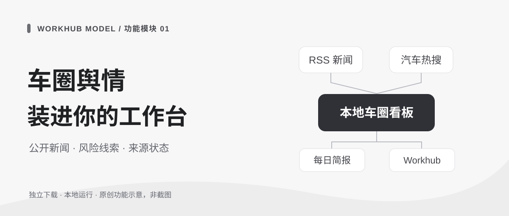

[简体中文](README.md) | [English](README.en.md)

# Workhub Model

**Download independent feature modules and connect them to Workhub.** The repository keeps the requested name, `workhub-model`; it distributes feature source, portable settings and prompts rather than model weights.



## First module: automotive opinion monitoring

Collect public automotive headlines and relevant trending topics. Review negative-keyword signals first, followed by Li Auto, domestic manufacturers, international news and trends. Search and filter a compact dashboard by date, category and keyword while retaining sources and collection status.

- Thirteen collection inputs: ten Google News RSS queries, Electrek, Carscoops and Baidu trends.
- User-configured proxy support. Network failures, parsing failures and empty filtered results have distinct states; one failed source does not stop the others.
- If every source fails, retain the previous valid data and show the failed attempt. Keyword labels are verification leads, not confirmed events.
- Python standard library; collection needs no API key. Use the included brief prompt with your preferred agent for optional summaries.


Workhub’s existing Codex Light is the default: white content, light gray surfaces and dark text, sharing Workhub’s compact layout and palette system. Existing saved color preferences are preserved.

## Download and try

Use Python 3.10 or newer. Download a standalone module ZIP from [Releases](https://github.com/8eeth0ven/workhub-model/releases), or clone the repository and select a module:

```sh
git clone https://github.com/8eeth0ven/workhub-model.git
cd workhub-model
python3 manage.py list
python3 manage.py install auto-opinion --output ../workhub-local/auto-opinion
```

Installation copies source only. It does not collect news, execute module scripts, create schedules or change global settings. Existing destinations are not overwritten.

Try clearly labeled fictional data offline:

```sh
cd ../workhub-local/auto-opinion
python3 bin/collect.py --demo --data-dir demo/data
python3 bin/build_data.py --data-dir demo/data
```

Open the generated `site/index.html`. Demo data uses a separate `demo/data/` directory; live data uses `data/`. Never mix them in one directory. For live collection, copy `config.example.json` to `config.json`, configure a proxy if needed, run `python3 bin/collect.py --config config.json`, then rebuild the dashboard.

## Connect to Workhub

Run this explicitly from the repository. Point `--workhub` to your [Workhub](https://github.com/8eeth0ven/workhub) checkout:

```sh
python3 manage.py connect auto-opinion \
  --installed ../workhub-local/auto-opinion --workhub ../workhub
```

Build the dashboard first. Connecting registers the project and static site and adds project-level required-reading entries. It does not start collection or create an automation. In Workhub versions with manual workspace admission, select the module directory in Add project and add it yourself; registration alone does not admit it.

See the [module guide](modules/auto-opinion/README.en.md) and [module format](docs/modules.en.md).

## Published contents

Source and ZIP exports contain only explicitly listed runtime files, example settings, bilingual documentation and sanitized prompts. Real reports, logs, personal paths, automation identifiers, sessions, keys, generated dashboards and test files are excluded. Documentation graphics are original illustrations; offline demo items are explicitly fictional.

```sh
python3 scripts/audit_release.py
python3 manage.py package auto-opinion --output ../auto-opinion-0.1.0.zip
```

Public feeds and their network availability can change. Installing a module does not establish connectivity in your environment. Inspect source health before deciding whether the available news is complete.
