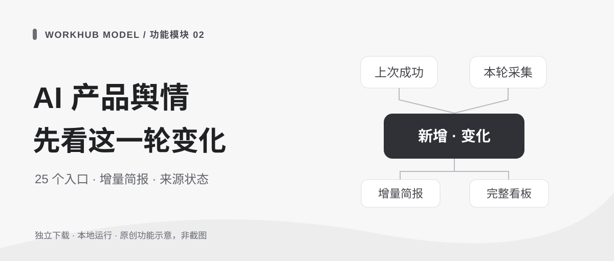
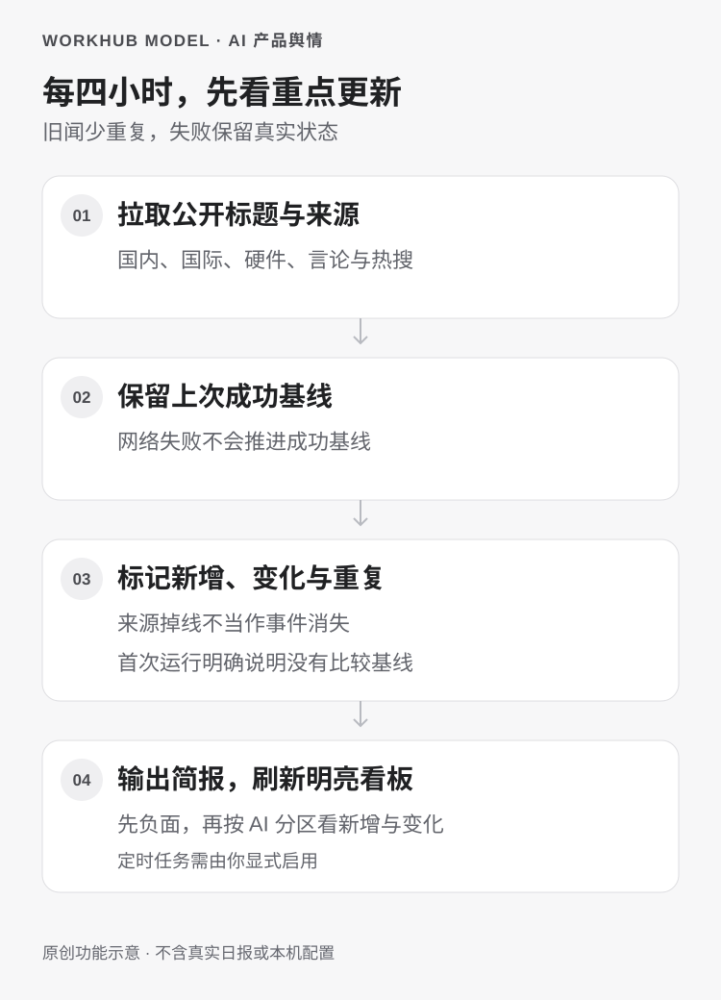

[简体中文](README.md) | [English](README.en.md)

# Workhub Model

**Download independent feature modules and connect them to Workhub.** This repository provides feature source, example settings and prompts rather than model weights.

| Module | Purpose | Guide and download |
| --- | --- | --- |
| Automotive opinion monitor | Automotive news, Li Auto, risk keywords and trends | [Guide](modules/auto-opinion/README.en.md) · [ZIP](https://github.com/8eeth0ven/workhub-model/releases/download/v0.1.0/auto-opinion-0.1.0.zip) |
| AI product opinion monitor | Products, models, hardware, public statements and trends; new and changed material first | [Guide](modules/ai-opinion/README.en.md) · [ZIP](https://github.com/8eeth0ven/workhub-model/releases/download/ai-opinion-v0.1.0/ai-opinion-0.1.0.zip) |



Modules share Workhub’s existing **Codex Light**, compact layout and palette protocol, with dark and other palettes available. They install independently, keep separate data and are not tied to the original device or automation.

## Download and try

Use Python 3.10 or newer. Download a standalone ZIP from [Releases](https://github.com/8eeth0ven/workhub-model/releases), or clone and select a module:

```sh
git clone https://github.com/8eeth0ven/workhub-model.git
cd workhub-model
python3 manage.py list
python3 manage.py install ai-opinion --output ../workhub-local/ai-opinion
```

Installation only copies explicitly listed source files. It does not collect, execute modules, create schedules, change global settings or overwrite an existing destination. Use `auto-opinion` for the automotive module.

Try clearly labeled fictional material offline:

```sh
cd ../workhub-local/ai-opinion
python3 bin/collect.py --demo --data-dir demo/data
python3 bin/build_data.py --data-dir demo/data
```

Open `site/index.html`. For live collection, copy `config.example.json` to `config.json`, configure a proxy if required, then run `python3 bin/collect.py --config config.json` and rebuild. Live data defaults to `data/` and cannot share the demo directory.

## Incremental AI reading

The 25 inputs are 23 Google News RSS query groups, TechCrunch AI and AI-related Baidu trends. Articles use an exact 48-hour window. Request failures, parsing errors and valid empty results are distinct. Complete failure retains the last usable snapshot.

Successful baselines and deltas support multiple runs on the same day. The dashboard prioritizes new and changed material and offers a full view. Missing/restored sources or changed ordering do not establish disappearing events. Missing baselines, incomplete coverage and retained data are stated explicitly. Keywords are verification leads, not confirmed facts.



The module includes a [brief prompt](modules/ai-opinion/prompts/daily-brief.en.md) and [four-hour schedule card](modules/ai-opinion/prompts/automation-card.en.md). Collection needs no model key; use your chosen agent for optional summaries. The card is guidance, not an installed automation.

## Connect to Workhub

Build the dashboard, then explicitly run this from the repository:

```sh
python3 manage.py connect ai-opinion   --installed ../workhub-local/ai-opinion --workhub ../workhub
```

Point `--workhub` to your [Workhub](https://github.com/8eeth0ven/workhub) checkout. Connecting registers a project and website only. Versions with manual admission require you to select the module directory in Add project and admit it. Following the portal palette is also an explicit choice.

## Published contents

Source and ZIP exports contain only runtime source, example settings, bilingual guides and sanitized prompts. Real reports, logs, personal paths, task identities, sessions, keys, incremental state, generated dashboards and test files are excluded. Installation does not modify existing desktop projects or their automations.

```sh
python3 scripts/audit_release.py
python3 manage.py package ai-opinion --output ../ai-opinion-0.1.0.zip
```

See the [module format](docs/modules.en.md) for extension details. Public interfaces and network availability can change. Installing a module does not establish continuous coverage in every environment; inspect source health before judging completeness.
