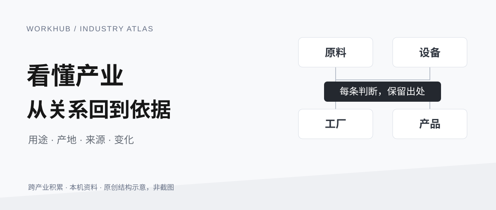
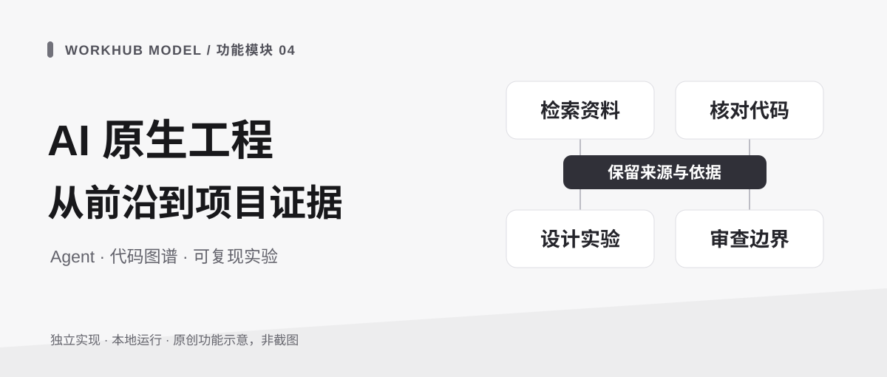

[简体中文](README.md) · [English](README.en.md)

# Workhub Model

Independent local modules for public updates, industry knowledge and learning. Install what you need and switch within Workhub. This repository provides feature source, examples and prompts, not model weights.

| Module | Purpose |
| --- | --- |
| [Automotive news](modules/auto-opinion/README.en.md) | Carmaker headlines, a Li Auto section and automotive trends |
| [AI product news](modules/ai-opinion/README.en.md) | Reports added or changed since the previous successful collection |
| [Compute value chain](modules/compute-search/README.en.md) | GPU catalog rates, vendor announcements and seven industry segments |
| [Industry knowledge atlas](modules/industry-atlas/README.en.md) | Cross-industry purposes, location roles, relationship evidence and change history |
| [Code & graph learning](modules/coding-graph/README.en.md) | AI-native release samples, 17 advanced resources and local Python static graphs |
| [English in slices](modules/english-slices/README.en.md) | Personal-list imports, continuous browsing, speech and original everyday phrases |

Use Python 3.10 or later. From the repository root, install to a new folder, or download a standalone ZIP from [Releases](https://github.com/8eeth0ven/workhub-model/releases).

```sh
python3 manage.py list
python3 manage.py install industry-atlas --output ../workhub-local/industry-atlas
```

Installation copies explicitly listed source files. Follow each module's README to collect, import or start its service, then use the page directly or connect it to Workhub. Codex Light, ten palettes and bilingual controls share one design system. [Module integration and packaging](docs/modules.en.md)

<details>
<summary>Industry atlas · Visual guide</summary>




</details>

<details>
<summary>Code & graph learning · Visual guide</summary>




</details>

<details>
<summary>English in slices · Visual guide</summary>


</details>

The atlas ships fictional examples only; import real research yourself. Coding samples one page of up to six releases per repository, then filters the past 90 days. Static relations are not execution proof. English includes 48 original words, 24 phrases and eight scenes, without membership-list migration.

Real data, settings, keys, sessions, logs and generated pages stay local and are excluded from source and ZIP releases, as are test-only files. Disclosures, inferences and hypotheses remain distinct. Relations do not establish exclusive supply, causality or investment value.
