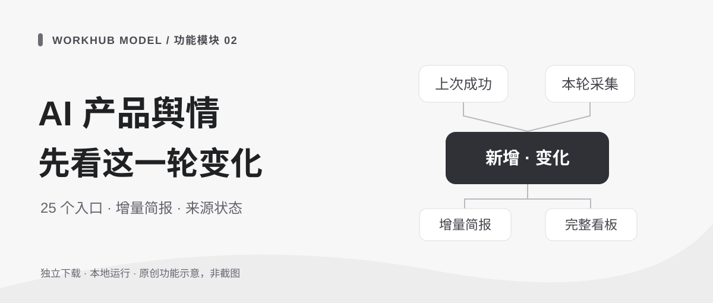

[简体中文](README.md) | [English](README.en.md)

# Workhub Model

**给 Workhub 下载和接入独立功能模块。** 这里提供功能源码、配置示例和提示词，不是模型权重。

| 模块 | 用途 | 说明与下载 |
| --- | --- | --- |
| 车圈舆情监控 | 汽车新闻、理想专项、风险关键词与热搜 | [说明](modules/auto-opinion/README.md) · [ZIP](https://github.com/8eeth0ven/workhub-model/releases/download/v0.1.0/auto-opinion-0.1.0.zip) |
| AI 产品舆情监控 | 产品、模型、硬件、公开言论与热搜，每轮先看新增和变化 | [说明](modules/ai-opinion/README.md) · [ZIP](https://github.com/8eeth0ven/workhub-model/releases/download/ai-opinion-v0.1.0/ai-opinion-0.1.0.zip) |



模块共用 Workhub 已有的 **Codex 明亮**、紧凑布局与配色协议，保留深色和其他配色。各模块独立安装、独立保存资料，不绑定原设备或自动化。

## 下载与试用

需要 Python 3.10 或更新版本。从 [Releases](https://github.com/8eeth0ven/workhub-model/releases) 下载独立 ZIP，或克隆仓库后选择模块：

```sh
git clone https://github.com/8eeth0ven/workhub-model.git
cd workhub-model
python3 manage.py list
python3 manage.py install ai-opinion --output ../workhub-local/ai-opinion
```

安装只复制明确清单里的源码，不采集、不运行模块、不创建定时任务或修改全局配置，也不覆盖已有目录。车圈模块将 ID 换为 `auto-opinion` 即可。

离线体验使用明确标注的虚构资料：

```sh
cd ../workhub-local/ai-opinion
python3 bin/collect.py --demo --data-dir demo/data
python3 bin/build_data.py --data-dir demo/data
```

打开 `site/index.html`。真实采集时复制 `config.example.json` 为 `config.json`，按需配置代理，再执行 `python3 bin/collect.py --config config.json` 和构建命令。真实资料默认放在 `data/`，不能与演示目录混用。

## AI 模块的增量阅读

25 个采集入口：23 组 Google News RSS 查询、TechCrunch AI 和百度 AI 热搜。新闻窗口为精确过去 48 小时。请求失败、解析错误和正常无匹配分别记录；全部失败保留上次可用数据。

同日多轮也保留成功基线与增量结果，看板优先展示新增和变化，可切全量。来源掉线、恢复或排列变化不能证明事件消失；首次没有基线、覆盖不足和旧数据都会说明。关键词只是待核验线索。


模块附 [简报提示词](modules/ai-opinion/prompts/daily-brief.md) 和 [每四小时注册卡](modules/ai-opinion/prompts/automation-card.md)。采集无需模型 Key；总结可交给自己选择的 Agent。注册卡是配置参考，不代表任务已创建。

## 接进 Workhub

先生成看板，再从仓库目录显式执行：

```sh
python3 manage.py connect ai-opinion   --installed ../workhub-local/ai-opinion --workhub ../workhub
```

`--workhub` 指向自己的 [Workhub](https://github.com/8eeth0ven/workhub) 源码目录。连接只登记项目与网站；新版采用手动入库时，还需你在「接入项目」选择模块目录并加入中控。跟随门户配色同样是显式选项。

## 发布边界

源码与 ZIP 只包含运行源码、示例配置、双语文档和脱敏提示词。真实日报、日志、个人路径、任务身份、会话、密钥、增量状态、生成看板和测试文件均不随包发布。已有桌面项目和自动化不因安装被修改。

```sh
python3 scripts/audit_release.py
python3 manage.py package ai-opinion --output ../ai-opinion-0.1.0.zip
```

扩展方式见 [模块协议](docs/modules.md)。第三方接口和网络会变化；安装成功不代表所有源在每个环境持续可用，先看采集状态，再判断资料是否完整。
