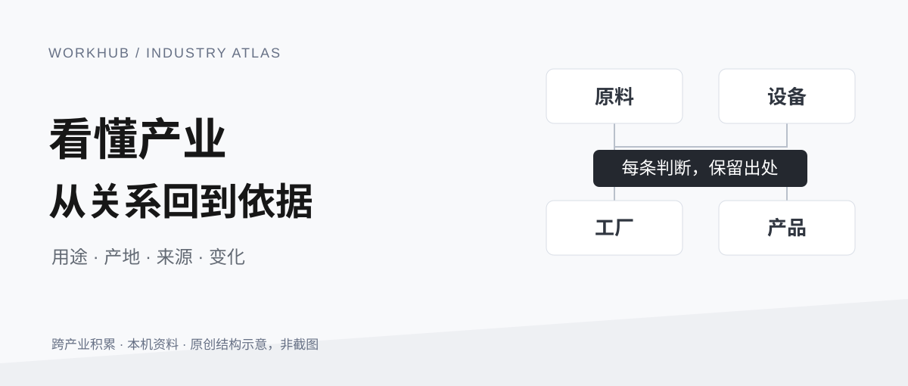
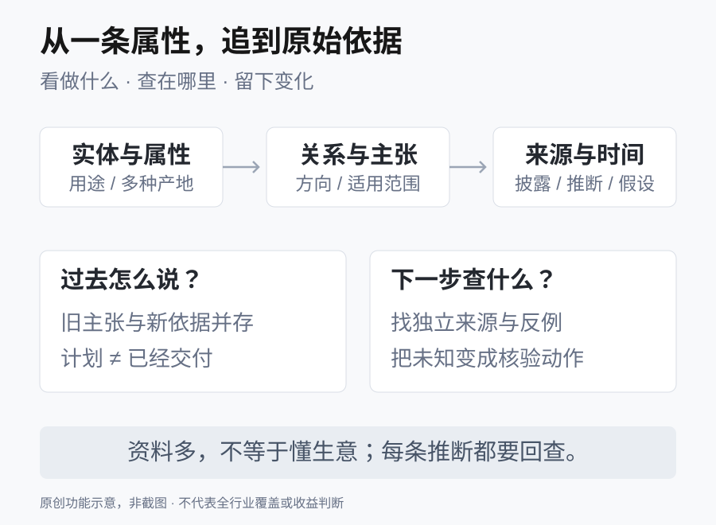
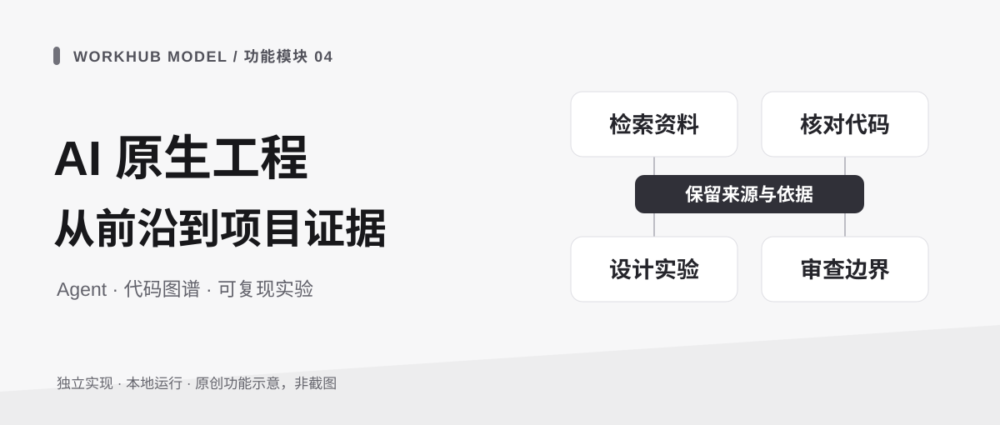
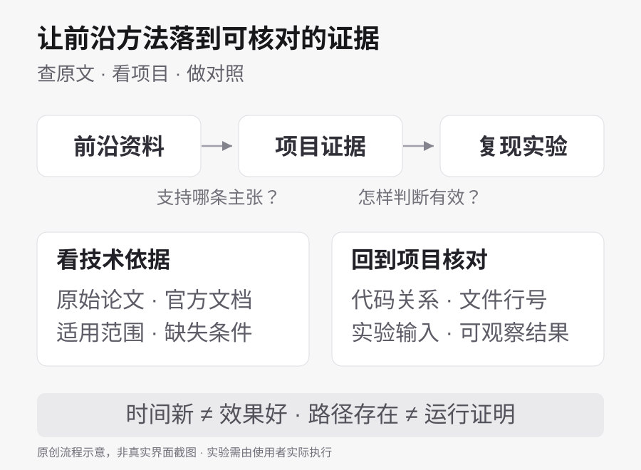
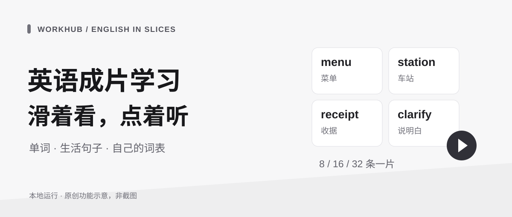
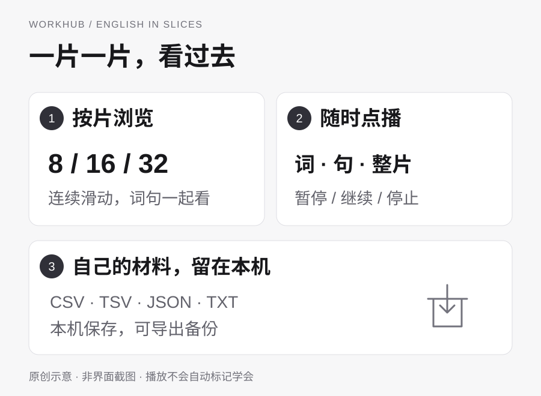

[简体中文](README.md) · [English](README.en.md)

# Workhub Model

把公开动态、产业知识和学习资料放进独立的本地模块。按需安装、接入 Workhub，在同一个工作空间切换。这里提供功能源码、示例与提示词，不是模型权重。

| 模块 | 用途 |
| --- | --- |
| [车圈舆情](modules/auto-opinion/README.md) | 国内外车企新闻、理想汽车动态与热搜 |
| [AI 产品舆情](modules/ai-opinion/README.md) | 与上次成功采集相比，哪些报道新增或变化 |
| [算力产业链](modules/compute-search/README.md) | GPU 目录报价、厂商公告及七个产业环节 |
| [产业知识图谱](modules/industry-atlas/README.md) | 跨产业整理作用、不同产地、上下游证据与历史变更 |
| [代码与图检索](modules/coding-graph/README.md) | AI 原生工程发布采样、17 份进阶资料与本机 Python 静态图 |
| [英语成片学习](modules/english-slices/README.md) | 词表导入、连续列表、点播和原创生活句子 |

Python 3.10+。在仓库根目录安装到新目录，或从 [Releases](https://github.com/8eeth0ven/workhub-model/releases) 下载独立 ZIP。

```sh
python3 manage.py list
python3 manage.py install industry-atlas --output ../workhub-local/industry-atlas
```

安装只复制清单里的源码。按模块 README 显式采集、导入或启动服务，生成页面后独立使用或接进 Workhub。界面沿用 Codex 明亮与十套配色，中英文切换保留当前内容。[模块接入与打包说明](docs/modules.md)

<details>
<summary>产业图谱 · 看图了解</summary>





</details>

<details>
<summary>代码与图检索 · 看图了解</summary>





</details>

<details>
<summary>英语成片学习 · 看图了解</summary>





</details>

产业图谱下载包仅带虚构演示，真实资料自行导入。Coding 发布采样每仓只读一页最多六条，再筛近九十天；静态关系不等于运行证明。英语预置为 48 个自编词、24 句、八个场景，不包含会员词表迁移。

真实资料、配置、Key、会话、日志和生成页面保存在本机，不随源码或 ZIP 发布；测试专用内容同样排除。来源披露、推断和假设分别保留，关系不自动证明独家供应、因果或投资价值。
