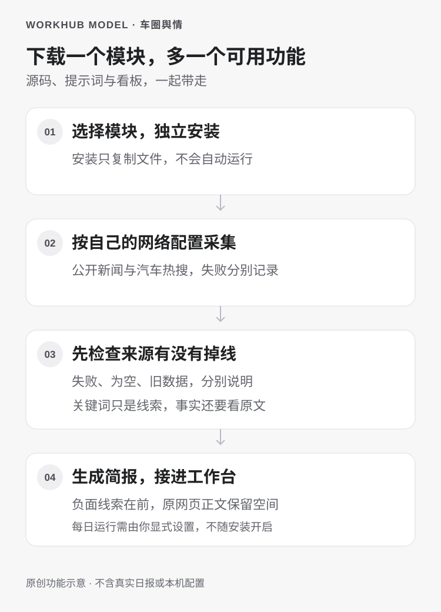

[简体中文](README.md) | [English](README.en.md)

# Workhub Model

**给 Workhub 下载和接入独立功能模块。** 这里存放模块源码、可移植配置和使用提示词；仓库名沿用 `workhub-model`，内容是功能模块，不是模型权重。


## 第一个模块：车圈舆情监控

汇总公开汽车新闻和汽车相关热搜，先看负面关键词线索，再看理想专项、国内车企、国际车圈与热搜。保留来源和采集状态，在紧凑看板中按日期、分类和关键词查找。

- Google News RSS 的 10 组查询、Electrek、Carscoops、百度热搜，共 13 个采集入口。
- 代理由使用者配置；网络错误、解析错误、筛选后为空分别展示。某个源失败不拖垮其他源。
- 全部源失败时保留上次有效数据，明确提示本轮失败；关键词分级只是核验线索，不代表事件已经证实。
- 标准库 Python，无需 API Key。公众号或日报总结可复用模块内的提示词，交给自己选择的 Agent。



默认采用明亮风格：白色内容、浅灰底色、深色文字，与 Workhub 共用配色和紧凑排版；已有保存的配色偏好继续保留。

## 下载与试用

需要 Python 3.10 或更新版本。从 [Releases](https://github.com/8eeth0ven/workhub-model/releases) 下载独立模块 ZIP，或克隆仓库后选择安装：

```sh
git clone https://github.com/8eeth0ven/workhub-model.git
cd workhub-model
python3 manage.py list
python3 manage.py install auto-opinion --output ../workhub-local/auto-opinion
```

安装只复制源码，不自动采集、运行命令、创建定时任务或修改全局配置。目标目录已存在时拒绝覆盖。

离线体验使用明确标注的虚构数据：

```sh
cd ../workhub-local/auto-opinion
python3 bin/collect.py --demo --data-dir demo/data
python3 bin/build_data.py --data-dir demo/data
```

直接打开生成的 `site/index.html`。演示资料放在独立的 `demo/data/`，真实采集使用默认 `data/`，两者不能混用。真实采集时，复制 `config.example.json` 为 `config.json`，按需配置代理，然后执行 `python3 bin/collect.py --config config.json`，再运行构建命令。

## 接进 Workhub

在仓库目录显式执行，`--workhub` 指向自己的 [Workhub](https://github.com/8eeth0ven/workhub) 源码目录：

```sh
python3 manage.py connect auto-opinion \
  --installed ../workhub-local/auto-opinion --workhub ../workhub
```

先生成看板再连接。连接会登记项目和静态网站、追加该项目的必读入口；不会启动采集或创建自动化。

模块说明见 [车圈舆情监控](modules/auto-opinion/README.md)，新模块格式与打包方式见 [模块协议](docs/modules.md)。

## 发布内容

源码与 ZIP 只包含明确列出的运行文件、配置示例、双语文档和脱敏提示词。真实日报、日志、本机路径、自动化标识、会话、密钥、生成看板及测试文件均不随包发布。文档配图是原创功能示意，离线示例明确标记为虚构。

```sh
python3 scripts/audit_release.py
python3 manage.py package auto-opinion --output ../auto-opinion-0.1.0.zip
```

公开数据源的网络、接口和内容覆盖会变化；安装成功不代表这些源已在使用者网络中连通。看到源缺失时，先检查源状态，再判断信息是否完整。
