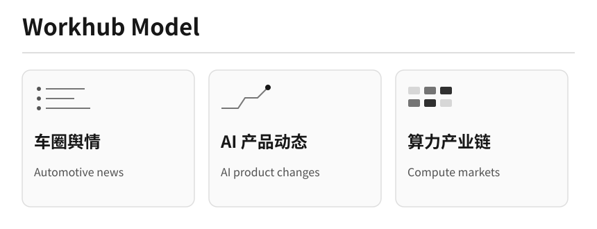

[简体中文](README.md) · [English](README.en.md)

# Workhub Model

三个独立模块把公开新闻或价格资料整理成本地看板。选择一个模块，照着它的 README 运行离线示例或开始采集。



| 模块 | 看什么 |
| --- | --- |
| [车圈舆情](modules/auto-opinion/README.md) | 国内外车企新闻、理想汽车动态与热搜 |
| [AI 产品舆情](modules/ai-opinion/README.md) | 与上次成功采集相比，哪些报道新增或发生变化 |
| [算力产业链](modules/compute-search/README.md) | GPU 目录报价、厂商公告及七个产业环节 |

Python 3.10+。在仓库根目录安装到新目录，也可从 [Releases](https://github.com/8eeth0ven/workhub-model/releases) 下载独立 ZIP。

```sh
python3 manage.py list
python3 manage.py install ai-opinion --output ../workhub-local/ai-opinion
```

安装只复制模块文件。首次采集和定时运行由你启动，报告与配置保存在本机。生成看板后可独立打开或接入 Workhub。[模块接入与打包说明](docs/modules.md)
