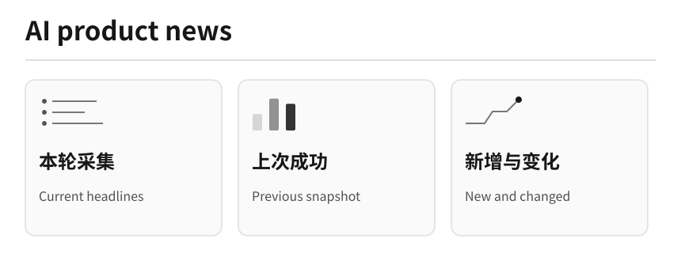

[简体中文](README.md) · [English](README.en.md)

# AI product news

Track AI products, models, hardware and public statements. Compare each run with the last usable snapshot to read new or changed stories first. Related reports share one card with all source links. Recurrence labels count dates in local saved reports, and a snapshot with no new or changed cards opens in the full view.

The default inputs combine domestic and international AI feeds, publisher blogs and Baidu trends. Google News search is optional; see the collection guide for source and filter limits.



Build the offline sample in this module directory using Python 3.10+, then open `site/index.html`.

```sh
python3 bin/collect.py --demo --data-dir demo/data
python3 bin/build_data.py --data-dir demo/data
```

To collect live records, use the separate `data/` directory.

```sh
cp config.example.json config.json
python3 bin/collect.py --config config.json
```

Live collection using the default data directory automatically rebuilds the dashboard. For a custom data directory, pass `--site-output-dir` to choose an output. Build failures return a nonzero exit status. The first run establishes a baseline. Subsequent changes are listed in `data/delta.json`. Check source failures in `data/last-run.json` and open the original report before interpreting a missing headline.

[Collection and comparison rules](docs/collector.en.md) · [Brief prompt](prompts/daily-brief.en.md) · [Optional schedule](prompts/automation-card.en.md)

[Local service and shared model configuration](docs/service.en.md): explicitly start collection or analysis; no schedule is created.
