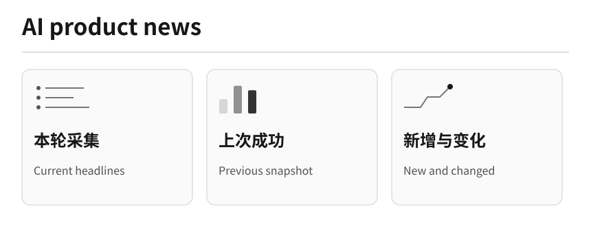

[简体中文](README.md) · [English](README.en.md)

# AI 产品舆情

汇集 AI 产品、模型、硬件和公开发言。把本轮新闻与上一份可用快照比较，先读新增或有变化的条目。同题报道合为一张卡，保留多来源，并标注本机日报里的连续或累计出现日期；没有增量时自动展示全量。

默认使用国内外 AI 新闻、官方博客和百度热搜；原 Google News 搜索保留为可选来源。来源故障和筛选边界见采集说明。



在本模块目录用 Python 3.10+ 构建离线示例，完成后打开 `site/index.html`。

```sh
python3 bin/collect.py --demo --data-dir demo/data
python3 bin/build_data.py --data-dir demo/data
```

采集真实数据时，下面的命令会把快照保存到单独的 `data/` 目录。

```sh
cp config.example.json config.json
python3 bin/collect.py --config config.json
```

真实采集使用默认数据目录时，会在采集后自动构建看板；自定义数据目录可同时指定 `--site-output-dir`。构建失败会返回非零状态。首次采集建立基线。之后对照 `data/delta.json` 看变化，打开原文核实标题。`data/last-run.json` 记录来源掉线的情况。解读新闻缺失前，先核对该来源的采集状态。

[采集与增量规则](docs/collector.md) · [简报提示词](prompts/daily-brief.md) · [定时配置示例](prompts/automation-card.md)

[独立服务和共享模型配置](docs/service.md)：在页面主动点击采集或分析，不会自动创建定时任务。
