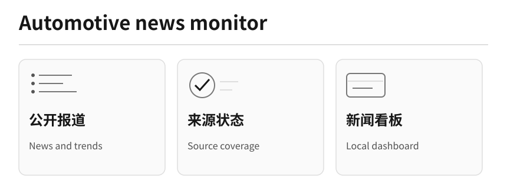

[简体中文](README.md) · [English](README.en.md)

# Automotive news monitor

Browse carmaker headlines and automotive trends. Filter by domestic or international news, Li Auto, or risk keywords, then open the original report.



Build the offline sample in this module directory using Python 3.10+, then open `site/index.html`.

```sh
python3 bin/collect.py --demo --data-dir demo/data
python3 bin/build_data.py --data-dir demo/data
```

To collect live records, use the separate `data/` directory.

```sh
cp config.example.json config.json
python3 bin/collect.py --config config.json
python3 bin/build_data.py
```

Use the date and source filters to review a headline in context. If collection fails, check `data/last-run.json` before relying on the displayed snapshot.

[Source and snapshot guide](docs/collector.en.md) · [Daily brief prompt](prompts/daily-brief.en.md)
