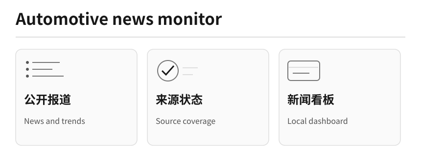

[简体中文](README.md) · [English](README.en.md)

# 车圈舆情监控

按来源整理车企新闻和汽车热搜，可筛选国内外车企、理想汽车和风险关键词，再打开原报道。



在本模块目录用 Python 3.10+ 构建离线示例，完成后打开 `site/index.html`。

```sh
python3 bin/collect.py --demo --data-dir demo/data
python3 bin/build_data.py --data-dir demo/data
```

采集真实数据时，下面的命令会把快照保存到单独的 `data/` 目录。

```sh
cp config.example.json config.json
python3 bin/collect.py --config config.json
python3 bin/build_data.py
```

选看板中的日期和来源，把标题关键词当作待核实的线索。采集失败时，先查 `data/last-run.json`，再判断手中快照有多新。

[采集说明](docs/collector.md) · [日报提示词](prompts/daily-brief.md)
