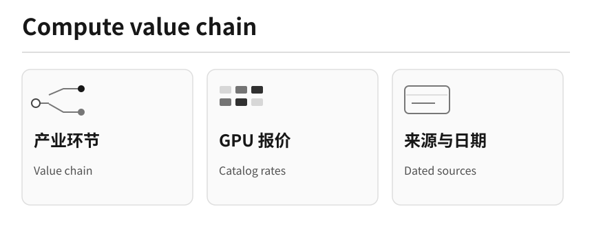

[简体中文](README.md) · [English](README.en.md)

# Compute value chain

Explore seven parts of the compute value chain, compare Runpod catalog rates by configuration, and read NVIDIA and AMD announcements.



Build the offline sample in this module directory using Python 3.10+, then open `site/index.html`.

```sh
python3 bin/build_data.py --demo
```

To collect live records, use the separate `data/` directory.

```sh
cp config.example.json config.json
python3 bin/collect.py --config config.json
python3 bin/build_data.py --input data/latest.json
```

Compare rates using the same region, GPU count, memory, currency and billing unit. Assessing utilization or returns also requires actual transactions and costs. `data/last-run.json` records source health for the current run.

[Research definitions](docs/research.en.md) · [Research brief prompt](prompts/research-brief.en.md)
