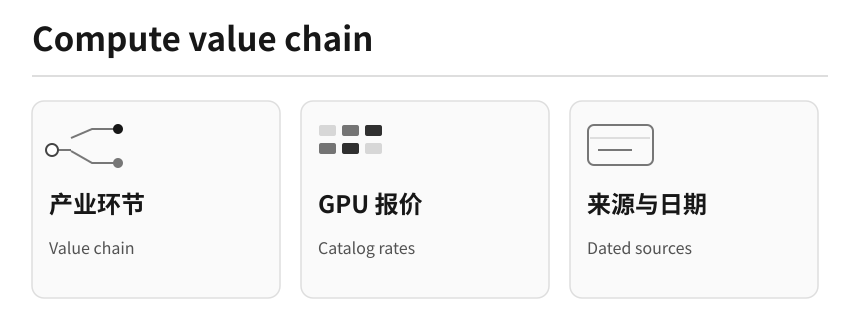

[简体中文](README.md) · [English](README.en.md)

# 算力产业链研究

用七张研究卡梳理算力产业链，按配置对照 Runpod 目录报价，并追踪 NVIDIA 与 AMD 的公开动态。



在本模块目录用 Python 3.10+ 构建离线示例，完成后打开 `site/index.html`。

```sh
python3 bin/build_data.py --demo
```

采集真实数据时，下面的命令会把快照保存到单独的 `data/` 目录。

```sh
cp config.example.json config.json
python3 bin/collect.py --config config.json
python3 bin/build_data.py --input data/latest.json
```

比较价格时核对地区、GPU 数量、显存、币种和计费单位。目录起价可作比较，判断利用率或收益还需核对成交与成本。`data/last-run.json` 记录本轮来源状态。

[研究口径](docs/research.md) · [研究简报提示词](prompts/research-brief.md)
